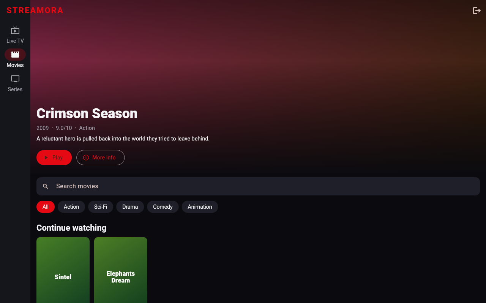
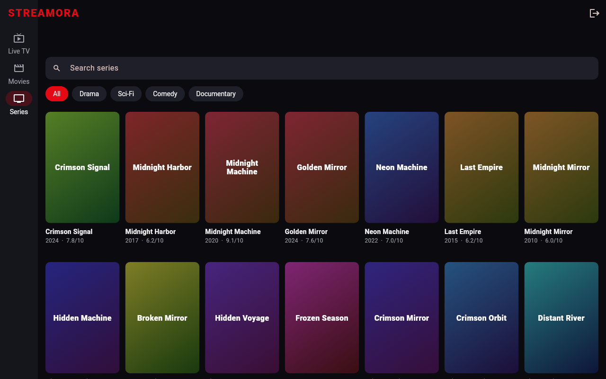
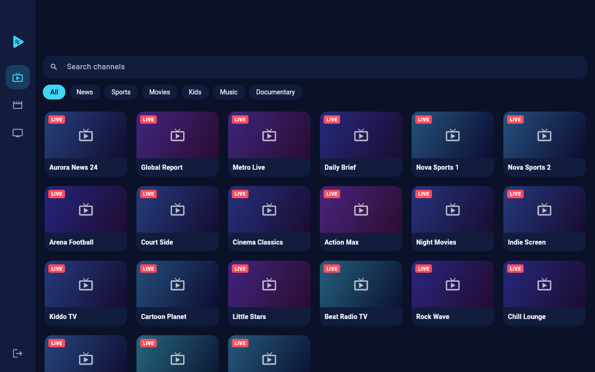
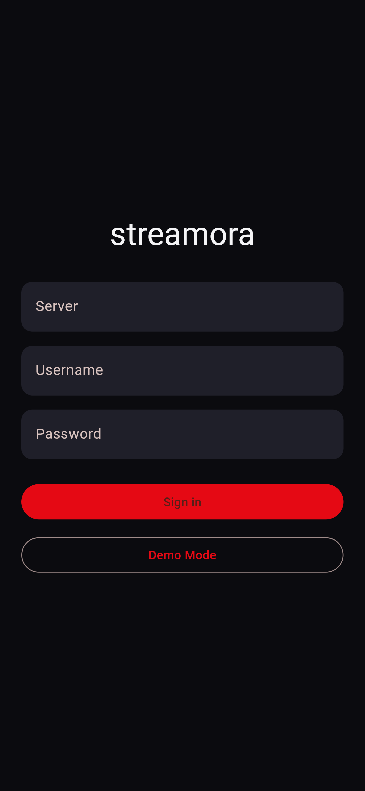
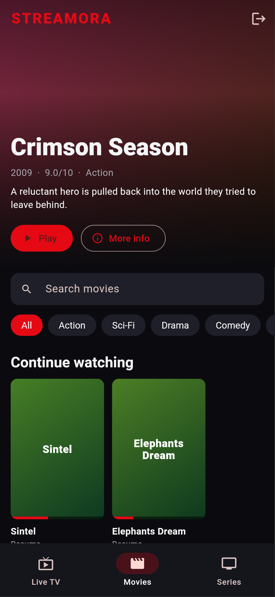
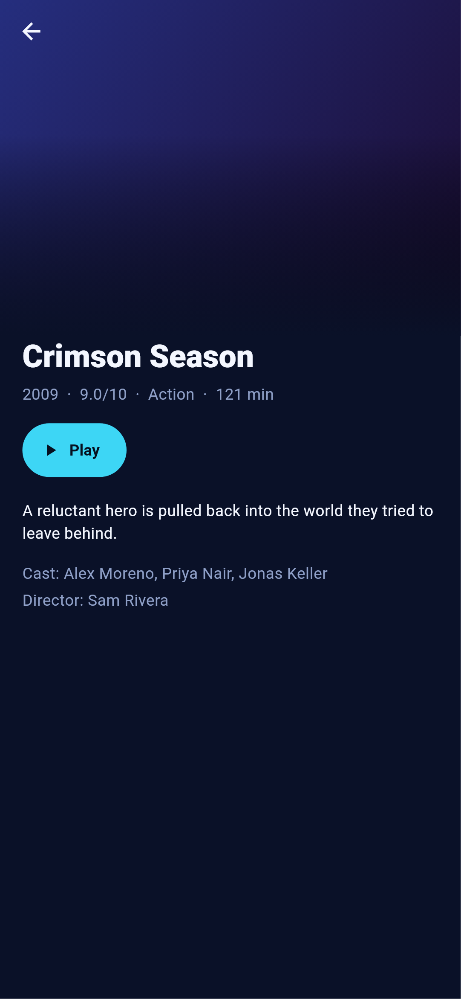
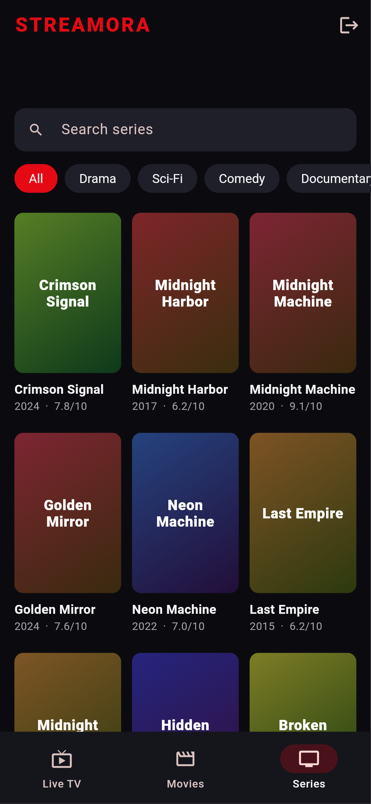
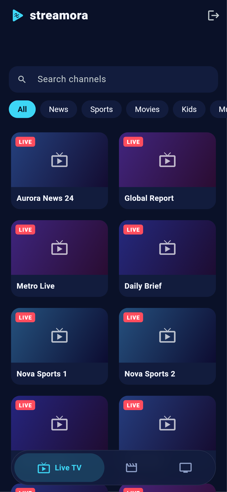

# streamora

Generic OTT player with a Netflix-style UI for **Android** and **Windows**, built with Flutter.

> Work in progress. No content is bundled; a **Demo Mode** with freely licensed Blender Foundation videos is planned.

## Screenshots
Rendered from the real app code with the bundled **Demo Mode** catalog (fictional titles, generated artwork). They are produced in CI by [`test/screenshots`](test/screenshots/screenshots_test.dart), so they always match the current UI. Layouts shown: Windows (1280x800, navigation rail) and Android phone (412x892, bottom navigation).

### Windows
| Movies | Movie detail |
|---|---|
|  |  |
| **Series** | **Live TV** |
|  |  |

### Android
| Login | Movies | Movie detail | Series | Live TV |
|---|---|---|---|---|
|  |  |  |  |  |

> Demo Mode streams open Blender Foundation films (CC BY) as placeholders for every title.

## Download
Installable builds are published in [GitHub Releases](../../releases):
- `streamora-android-vX.Y.Z.apk`
- `streamora-windows-vX.Y.Z-setup.exe` (installer) and `...-portable.zip`

## Architecture
`lib/features/<feature>/{domain,data,presentation}` plus `lib/shared`.
Layer rules are enforced by `test/architecture/layers_test.dart` and CI.

## Development
```
flutter pub get
flutter analyze --fatal-infos
flutter test
```
Changes are specified first with OpenSpec in `openspec/changes/`.

## Credits
Playback uses [media_kit](https://github.com/media-kit/media-kit) with the bundled [libmpv](https://mpv.io) (LGPL-2.1+), linked dynamically. Open demo videos by the [Blender Foundation](https://www.blender.org/about/projects/) (CC BY).

## License
Proprietary, all rights reserved. The source is visible but may not be used, copied, modified, distributed or monetized without written permission. See [LICENSE](LICENSE).
